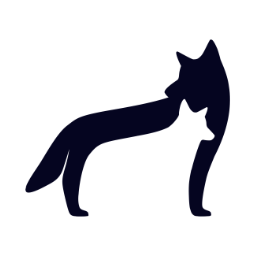

# Coywolf Reset Updates

> [!IMPORTANT]
> Coywolf Reset Updates is no longer developed. Coywolf moved all of its sites from WordPress to [EmDash](https://emdashcms.com), and the plugin features it still uses are now in [Coywolf Pack for EmDash](https://github.com/coywolf-llc/coywolf-pack). This repository is archived and read-only.

## Use Coywolf Pack instead

EmDash plugins, Coywolf Pack included, are installed and updated with npm, so there's no update cache to reset. Coywolf Pack's Update check puts a card on the EmDash dashboard when a new version is out (see [Updating](https://github.com/coywolf-llc/coywolf-pack#updating)).

To add Coywolf Pack to an EmDash site, follow its [Getting started](https://github.com/coywolf-llc/coywolf-pack#getting-started) guide.

## What this plugin did

Added a Tools → Reset Updates page with a button that cleared WordPress's cached update data and forced a recheck for new versions.

## If you still use it

The last release, [v1.0.30](https://github.com/coywolf-llc/reset-plugin-update/releases/tag/v1.0.30), is still available, but it won't get updates, security fixes or support. The code stays here under the GPL-2.0-or-later license.
